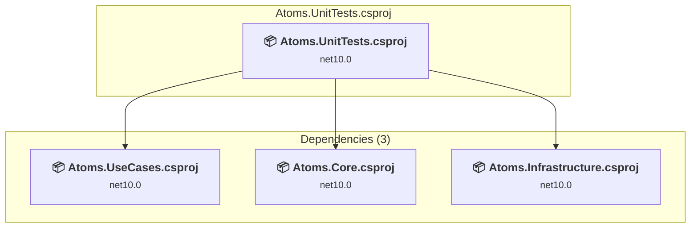

# test\Atoms.UnitTests\Atoms.UnitTests.csproj

[← Back to the assessment index](../../assessment.md)

## Project Info

- **Current Target Framework:** net10.0
- **Proposed Target Framework:** net11.0
- **SDK-style**: True
- **Project Kind:** DotNetCoreApp
- **Dependencies**: 3
- **Dependants**: 0
- **Number of Files**: 42
- **Number of Files with Incidents**: 1
- **Lines of Code**: 3589
- **Estimated LOC to modify**: 0+ (at least 0.0% of the project)

## Related Projects

**Depends on (3)** — projects this one references:

- [C:\Users\paulm\source\repos\atoms-blazor\src\Atoms.Core\Atoms.Core.csproj](../projects/Atoms.Core.md)
- [C:\Users\paulm\source\repos\atoms-blazor\src\Atoms.Infrastructure\Atoms.Infrastructure.csproj](../projects/Atoms.Infrastructure.md)
- [C:\Users\paulm\source\repos\atoms-blazor\src\Atoms.UseCases\Atoms.UseCases.csproj](../projects/Atoms.UseCases.md)

## Dependency Graph

Legend:
📦 SDK-style project
⚙️ Classic project

## API Compatibility

| Category | Count | Impact |
| :--- | :---: | :--- |
| 🔴 Binary Incompatible | 0 | High - Require code changes |
| 🟡 Source Incompatible | 0 | Medium - Needs re-compilation and potential conflicting API error fixing |
| 🔵 Behavioral change | 0 | Low - Behavioral changes that may require testing at runtime |
| ✅ Compatible | 7422 |  |
| ***Total APIs Analyzed*** | ***7422*** |  |

## NuGet Package Issues

| Package | Current Version | Suggested Version | Severity | Issue |
| :--- | :---: | :---: | :---: | :--- |
| Microsoft.Data.Sqlite.Core | 10.0.10 | 10.0.15 | 🟡 Potential | NuGet package upgrade is recommended |
| Microsoft.EntityFrameworkCore.InMemory | 10.0.10 | 10.0.15 | 🟡 Potential | NuGet package upgrade is recommended |
| Microsoft.EntityFrameworkCore.Sqlite | 10.0.10 | 10.0.15 | 🟡 Potential | NuGet package upgrade is recommended |

Every project affected by these packages, and the versions the repository settles on: [aggregate NuGet packages](../nuget/aggregate-packages.md).

