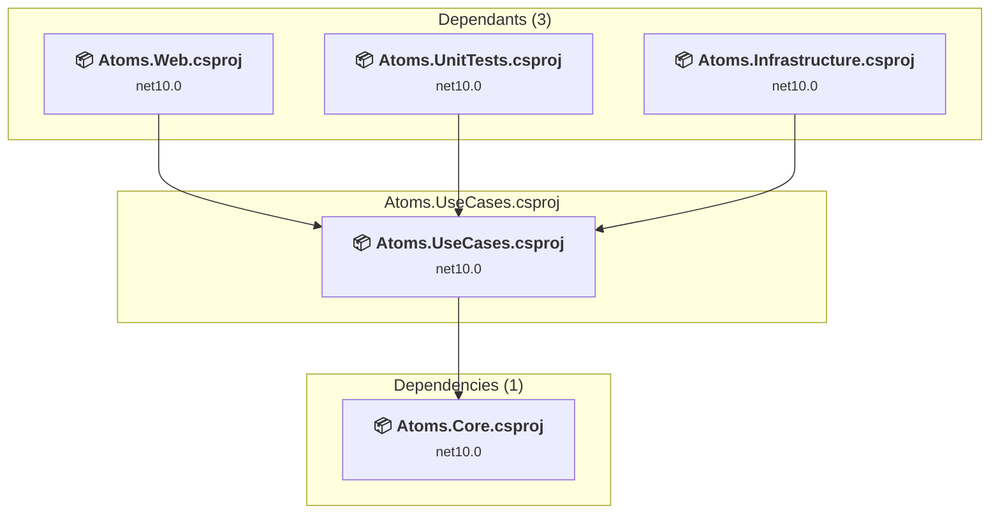

# src\Atoms.UseCases\Atoms.UseCases.csproj

[← Back to the assessment index](../../assessment.md)

## Project Info

- **Current Target Framework:** net10.0
- **Proposed Target Framework:** net11.0
- **SDK-style**: True
- **Project Kind:** ClassLibrary
- **Dependencies**: 1
- **Dependants**: 3
- **Number of Files**: 36
- **Number of Files with Incidents**: 1
- **Lines of Code**: 802
- **Estimated LOC to modify**: 0+ (at least 0.0% of the project)

## Related Projects

**Depends on (1)** — projects this one references:

- [C:\Users\paulm\source\repos\atoms-blazor\src\Atoms.Core\Atoms.Core.csproj](../projects/Atoms.Core.md)

**Depended on by (3)** — projects that reference this one:

- [C:\Users\paulm\source\repos\atoms-blazor\src\Atoms.Infrastructure\Atoms.Infrastructure.csproj](../projects/Atoms.Infrastructure.md)
- [C:\Users\paulm\source\repos\atoms-blazor\src\Atoms.Web\Atoms.Web.csproj](../projects/Atoms.Web.md)
- [C:\Users\paulm\source\repos\atoms-blazor\test\Atoms.UnitTests\Atoms.UnitTests.csproj](../projects/Atoms.UnitTests.md)

## Dependency Graph

Legend:
📦 SDK-style project
⚙️ Classic project

## API Compatibility

| Category | Count | Impact |
| :--- | :---: | :--- |
| 🔴 Binary Incompatible | 0 | High - Require code changes |
| 🟡 Source Incompatible | 0 | Medium - Needs re-compilation and potential conflicting API error fixing |
| 🔵 Behavioral change | 0 | Low - Behavioral changes that may require testing at runtime |
| ✅ Compatible | 844 |  |
| ***Total APIs Analyzed*** | ***844*** |  |

