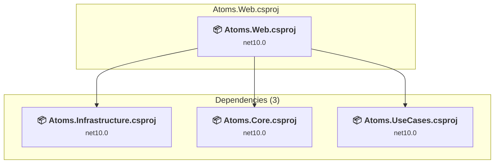

# src\Atoms.Web\Atoms.Web.csproj

[← Back to the assessment index](../../assessment.md)

## Project Info

- **Current Target Framework:** net10.0
- **Proposed Target Framework:** net11.0
- **SDK-style**: True
- **Project Kind:** AspNetCore
- **Dependencies**: 3
- **Dependants**: 0
- **Number of Files**: 81
- **Number of Files with Incidents**: 8
- **Lines of Code**: 2080
- **Estimated LOC to modify**: 23+ (at least 1.1% of the project)

## Related Projects

**Depends on (3)** — projects this one references:

- [C:\Users\paulm\source\repos\atoms-blazor\src\Atoms.Core\Atoms.Core.csproj](../projects/Atoms.Core.md)
- [C:\Users\paulm\source\repos\atoms-blazor\src\Atoms.Infrastructure\Atoms.Infrastructure.csproj](../projects/Atoms.Infrastructure.md)
- [C:\Users\paulm\source\repos\atoms-blazor\src\Atoms.UseCases\Atoms.UseCases.csproj](../projects/Atoms.UseCases.md)

## Dependency Graph

Legend:
📦 SDK-style project
⚙️ Classic project

## API Compatibility

| Category | Count | Impact |
| :--- | :---: | :--- |
| 🔴 Binary Incompatible | 1 | High - Require code changes |
| 🟡 Source Incompatible | 7 | Medium - Needs re-compilation and potential conflicting API error fixing |
| 🔵 Behavioral change | 15 | Low - Behavioral changes that may require testing at runtime |
| ✅ Compatible | 7101 |  |
| ***Total APIs Analyzed*** | ***7124*** |  |

## NuGet Package Issues

| Package | Current Version | Suggested Version | Severity | Issue |
| :--- | :---: | :---: | :---: | :--- |
| Microsoft.AspNetCore.DataProtection.EntityFrameworkCore | 10.0.10 | 10.0.15 | 🟡 Potential | NuGet package upgrade is recommended |
| Microsoft.AspNetCore.Diagnostics.EntityFrameworkCore | 10.0.10 | 10.0.15 | 🟡 Potential | NuGet package upgrade is recommended |
| Microsoft.AspNetCore.Identity.EntityFrameworkCore | 10.0.10 | 10.0.15 | 🟡 Potential | NuGet package upgrade is recommended |
| Microsoft.AspNetCore.SignalR.Client | 10.0.10 | 10.0.15 | 🟡 Potential | NuGet package upgrade is recommended |
| Microsoft.EntityFrameworkCore.Design | 10.0.10 | 10.0.15 | 🟡 Potential | NuGet package upgrade is recommended |
| Microsoft.VisualStudio.Azure.Containers.Tools.Targets | 1.23.0 | — | 🔴 Mandatory | NuGet package is incompatible |

Every project affected by these packages, and the versions the repository settles on: [aggregate NuGet packages](../nuget/aggregate-packages.md).

